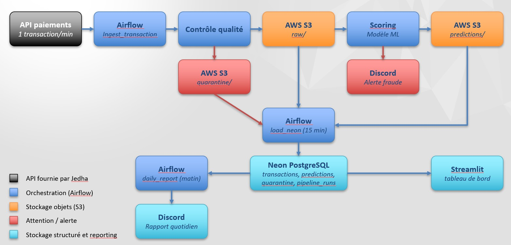

# Détection automatique de fraude — Pipeline de données pour l'IA

Certification AIA RNCP38777 - Bloc 2 : Concevoir et mettre en œuvre des pipelines de données (pour l'IA)


## Contexte et objectif

Le pipeline collecte des transactions en quasi temps réel, les valide, les score avec un
modèle de détection de fraude, notifie les fraudes détectées, archive tout dans un entrepôt
structuré, et produit un rapport quotidien ainsi qu'un tableau de bord de monitoring.


## Architecture



**Chemin quasi temps réel** (chaque minute) : l'API de paiements est interrogée par un DAG
Airflow, qui valide chaque transaction (schéma, montant, coordonnées, cohérence), la dépose
dans la zone brute de S3 (ou dans la quarantaine si elle est invalide), la score avec le
modèle entraîné, dépose la prédiction, et notifie sur Discord en cas de fraude détectée.

**Chemin par lots** (toutes les 15 minutes) : un second DAG relit les zones du jour dans S3
et les charge dans Neon (PostgreSQL), de façon idempotente (`ON CONFLICT DO NOTHING`), sans
état à mémoriser entre deux exécutions.

**Chaque matin**, un troisième DAG interroge Neon et envoie un rapport de synthèse (volumes,
fraudes détectées, lignes en quarantaine, anomalies) sur Discord.

**En continu**, un tableau de bord Streamlit interroge Neon à la demande pour visualiser les
tendances, le taux de fraude dans le temps, et l'état de santé du pipeline.


## Stack technique

| Brique | Outil | Rôle |
|---|---|---|
| Orchestration | Apache Airflow | Planification et automatisation des DAGs |
| Stockage brut | AWS S3 (MinIO en développement local) | Zone brute, quarantaine, prédictions |
| Stockage structuré | Neon (PostgreSQL serverless) | Transactions, prédictions, journal d'exécution |
| Modèle | scikit-learn | `HistGradientBoostingClassifier`, pipeline unique entraînement/production |
| Infrastructure as Code | Terraform | Bucket S3 (chiffrement, versioning, accès minimal) |
| Monitoring | Streamlit | Tableau de bord de suivi |
| Conteneurisation | Docker Compose | Environnement de développement reproductible |
| Notifications | Discord (webhook) | Alertes de fraude et rapport quotidien |

## Structure du dépôt

```
.
├── docker-compose.yml       # Environnement complet (Airflow, MinIO, Postgres, Streamlit)
├── .env.example             # Variables d'environnement à copier en .env (jamais commité)
├── data/                    # fraudTest.csv (non versionné, à télécharger séparément)
├── models/                  # Modèle entraîné (.joblib) et ses métadonnées (non versionnés)
├── src/                     # Logique métier, partagée par tous les DAGs
│   ├── features.py          #   Préparation des variables (entraînement ET production)
│   ├── train.py              #   Entraînement du modèle (découpage temporel, métriques)
│   ├── ingestion.py          #   Appel API, contrôle qualité, stockage S3/MinIO
│   ├── scoring.py             #   Chargement et scoring avec le modèle
│   ├── notify.py              #   Envoi des notifications (Discord/Slack)
│   ├── pipeline.py            #   Orchestration partagée (ingestion → scoring → notification)
│   ├── demo.py                 #   Sélection d'une fraude réelle pour la démonstration
│   ├── neon_loader.py          #   Chargement par lots S3 → Neon (ELT)
│   └── daily_report.py          #   Calcul et envoi du rapport quotidien
├── airflow/dags/             # Les 4 DAGs (ingestion, chargement Neon, rapport, démo)
├── dashboard/                # Tableau de bord Streamlit (app.py + requêtes SQL)
├── infra/
│   ├── main.tf                # Bucket S3 + utilisateur IAM (Terraform, AWS réel)
│   ├── local/create_bucket.py # Équivalent local (MinIO) du bucket Terraform
│   └── neon/schema.sql        # Schéma des tables Neon
└── docs/
    ├── architecture.jpg      # Export du schéma d'infrastructure (pour ce README)
    └── infra_schema.pptx     # Livrable "plan de l'infrastructure" (source éditable)
```

## Prérequis

- Docker Desktop (avec le backend WSL2 sous Windows)
- Un compte [Neon](https://neon.tech) (offre gratuite) avec un projet créé
- Un webhook Discord (voir plus bas)
- *(optionnel, pour le déploiement AWS réel)* Terraform, AWS CLI, et un compte AWS

## Installation

1. **Cloner le dépôt**, puis télécharger `fraudTest.csv` ([lien de l'énoncé](https://lead-program-assets.s3.eu-west-3.amazonaws.com/M05-Projects/fraudTest.csv)) dans `data/`.

2. **Copier `.env.example` en `.env`** et le compléter :

   | Variable | Description |
   |---|---|
   | `MINIO_ROOT_USER` / `MINIO_ROOT_PASSWORD` | Identifiants de MinIO (stockage local, imite S3) |
   | `AWS_ACCESS_KEY_ID` / `AWS_SECRET_ACCESS_KEY` / `AWS_REGION` / `S3_BUCKET` | AWS S3 |
   | `NOTIFY_WEBHOOK_URL` | URL du webhook Discord (Serveur → Intégrations → Webhooks) |
   | `NEON_CONNECTION_STRING` | Chaîne de connexion Neon (tableau de bord Neon → Connect) |
   | `HASH_SALT` | Secret de pseudonymisation des numéros de carte — à générer **une seule fois** (`python -c "import secrets;print(secrets.token_hex(16))"`) et ne plus changer |

3. **Lancer l'environnement** :
   ```bash
   docker compose up -d
   ```

4. **Entraîner le modèle**, directement dans le conteneur Airflow (garantit des versions de
   librairies identiques entre l'entraînement et le scoring) :
   ```bash
   docker compose exec airflow-scheduler python /opt/airflow/src/train.py /opt/airflow/data/fraudTest.csv
   ```

5. **Activer les DAGs** dans l'interface Airflow (`http://localhost:8081`, `admin`/`admin`) :
   `ingest_transactions` et `load_neon` s'exécutent automatiquement une fois activés ;
   `daily_report` et `demo_inject_fraud` se déclenchent manuellement (bouton *Trigger DAG*).

6. **Consulter le tableau de bord** : `http://localhost:8501`.

## Déploiement AWS (optionnel)

Le dossier `infra/` contient le code Terraform du bucket S3 réel (chiffrement, versioning,
accès public bloqué, rétention 90 jours, utilisateur IAM à droits minimaux) :

```bash
cd infra
terraform init
terraform plan  
terraform apply
```

Il suffit ensuite de remplacer, dans `.env`, l'usage de MinIO par les identifiants du vrai
bucket S3 (le code applicatif ne change pas : il utilise l'API S3 standard via `boto3`).

## Les DAGs Airflow

| DAG | Fréquence | Rôle |
|---|---|---|
| `ingest_transactions` | Chaque minute | Appelle l'API, valide, stocke, score, notifie si fraude |
| `load_neon` | Toutes les 15 minutes | Charge les zones S3 du jour dans Neon (idempotent) |
| `daily_report` | Chaque matin (6h UTC) | Envoie un résumé de la veille sur Discord |
| `demo_inject_fraud` | Manuel | Injecte une vraie fraude du dataset, pour la démonstration |

## Notes techniques

- **Idempotence** : chaque transaction est stockée sous une clé S3 basée sur `trans_num`
  (une réécriture écrase la précédente avec un contenu identique) ; le chargement Neon utilise
  `ON CONFLICT DO NOTHING`. Aucune alerte ni ligne ne peut donc être dupliquée.
- **Cohérence entraînement/production** : `features.py` est le seul endroit où les variables
  du modèle sont calculées, importé à l'identique par l'entraînement et le scoring.
- **Entraîner dans le même environnement que le scoring** (conteneur Airflow) est **obligatoire** :
  un entraînement fait ailleurs peut produire un modèle sérialisé avec des versions de
  scikit-learn/numpy incompatibles avec celles du conteneur.
- **Gouvernance** : le numéro de carte est haché (SHA-256 salé) avant tout stockage structuré ;
  aucune donnée personnelle n'entre dans les variables du modèle ; la zone brute expire après
  90 jours.
- **Limite connue** : une transaction peut, en cas d'incident, être stockée sans être scorée
  (échec du scoring après le stockage brut). Ce cas est surveillé (indicateur « non scorées »
  dans le rapport quotidien et le tableau de bord) plutôt que traité automatiquement — piste
  d'amélioration pour une version ultérieure (file de reprise, ou tâche de rattrapage).
